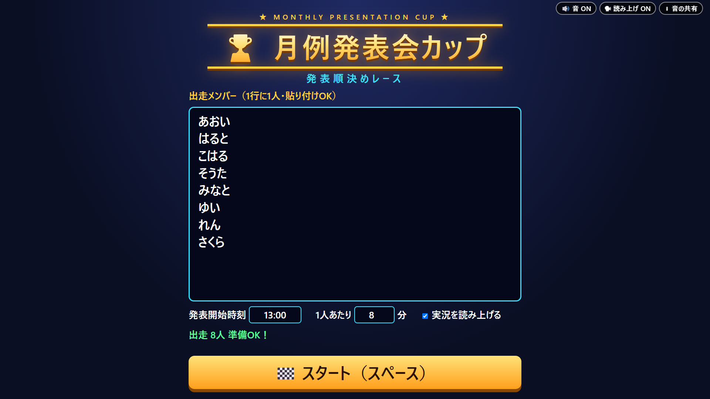
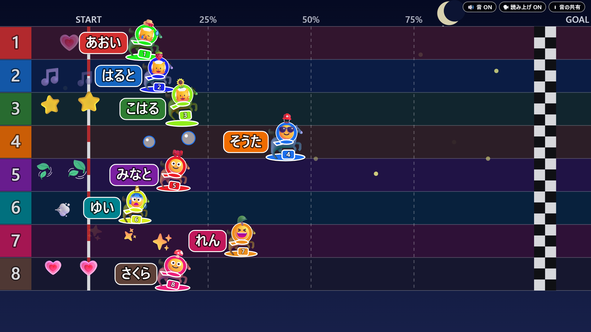
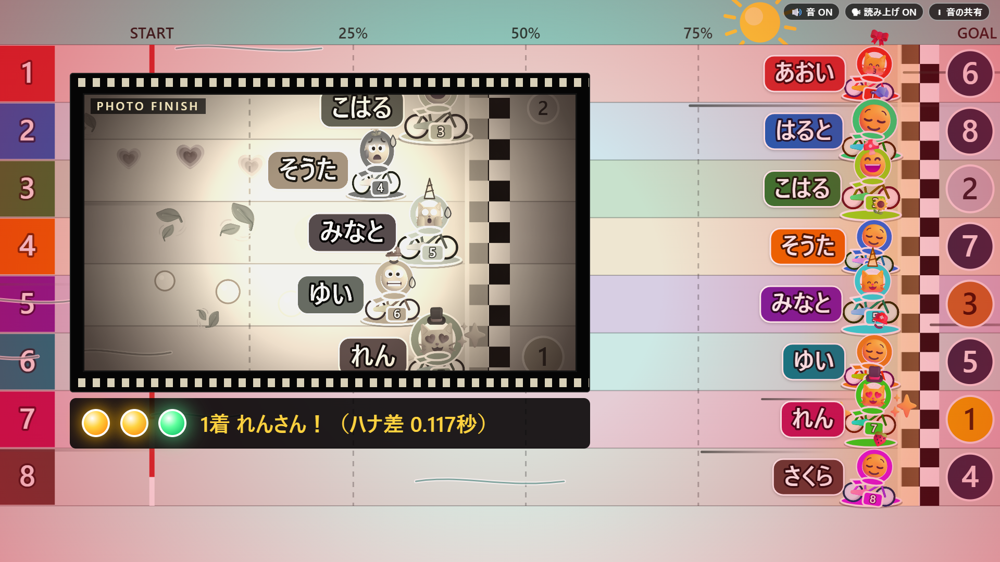
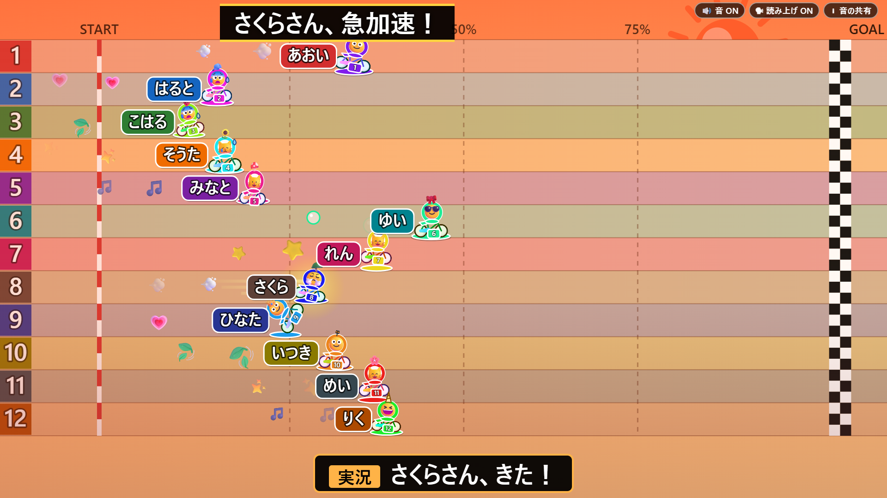

# 月例発表会カップ 発表順レース

毎月の発表会の「発表順」を、ちょっと盛り上がるレースで決める HTML 1ファイルのアプリです。インストール不要、サーバー不要、外部通信なし。ダブルクリックで動きます。

**ブラウザですぐ試す**：https://ksaiku.github.io/happyo-race/dist/ （社内で使うときは `dist/index.html` をダウンロードしてダブルクリック）



| レース中（8人） | 写真判定（8人） | 結果（8人） |
|---|---|---|
|  |  |  |

12人でも全員が1画面に収まります。

| レース中（12人） | 結果（12人） |
|---|---|
|  |  |

## 特長

### 公平です
- スタートした瞬間に、乱数（Fisher-Yates シャッフル）で全員の順位を先に決めます。
- レース中の動きは、その順位でゴールするように逆算して作っています。つまずきや入れ替わりなどの演出が起きても、最終順位は変わりません。
- 決めた順位から作る「封印コード」を、レース前の封筒に表示します。結果画面で開封して同じコードが出ることで、演出が順位に手を加えていないことを確認できます。

### 毎回違います
- 乗り物ガチャ：馬・カタツムリ・カメ・アヒル・ショッピングカートなど、毎回全員の乗り物が変わります。
- 天気予報：レース前に「本日の天気」を発表し、雨・霧・雪・夕焼け・夜などでコースの見た目が変わります（順位には影響しません）。

### 実況はボケとツッコミの掛け合い（v3）
- 実況役が走者をいじって煽り、解説役がすぐツッコみます（例：「○○さん、のんびり！」→「発表の準備中ですかね」）。最後尾・失速・転倒・逆走・急加速・帽子・乗り物など、その場の状況をネタにします。
- 結果画面では「トップバッターは○○さん！」「大トリは△△さん！」と締めの掛け合いを読み上げます。
- 掛け合いの尺のため、レース本体を26〜29秒にしました。

### 実況と画面がずれません（v2）
- 実況はその場の状況から生成し、字幕は読み上げが始まった瞬間に表示します（実測：字幕は生成から0.06〜0.3秒後で、内容はその時点の先頭・上位と一致）。古くなった文は捨てます。
- イベントの大テロップは、発生した時刻ぴったりに出ます。

### 終盤までハラハラします（v2）
- 終盤まで全員が団子状態で、後半40%で先頭交代が2回以上起きる割合は8人で99%。1着は約半分の回で、最後の3秒に差してきます。
- 終盤は足音が加速し、低いドローン音と心音が強まります。写真判定中は心音だけの静けさになります。
- 画面には赤い心拍ビネット、スピード線、「ラストスパート！」の帯（1.5秒で横切る）、「先頭交代！」テロップが出ます。

### 走者ごとに見た目が違います（v2）
- 毎レース、色（足元のマット・ゼッケン布・顔の縁・スカーフ）、帽子（14種）、顔（人／猫）、走り方（7種）、軌跡（7種）、大きさが走者ごとに変わります。
- 顔は状況で表情が変わります（先頭😎、後方😰、転倒😵、急加速😤、逆走🙃、1着🥳 など）。結果画面にも帽子と顔が出ます。

### 採用した8つの演出
1. 乗り物ガチャ
2. 天気予報ボードと天気ごとのコースの見た目
3. 入れ替わり閃光（画面が光った瞬間に2人の位置が入れ替わる）
4. フィルム式の写真判定と、判定ランプの焦らし
5. 二人実況（字幕と読み上げ）
6. 封印の封筒（封印コード）
7. フリーズしたふり（約3回に1回、「…ウソです！レース続行！」）
8. 発表タイムテーブルの自動生成（コピー可）

## 使い方

1. `dist/index.html` をダブルクリックして、Microsoft Edge または Google Chrome で開きます。
2. 準備画面で、出走メンバーを1行に1人ずつ入力します（貼り付け可。2〜12人）。前回の名前はブラウザに保存され、次回自動で表示されます。
3. オプションを設定します。
   - 発表開始時刻（例：13:00）
   - 1人あたりの分数（例：8）
   - 実況を読み上げる（チェック）
4. 「🏁 スタート（スペース）」ボタン、またはスペースキーでレースを始めます。天気予報、乗り物の発表、封印の封筒、カウントダウンのあとレースが始まります（スタート押下から結果画面まで約40秒）。
5. 結果画面に表彰台と発表順が出ます。
   - 「📋 タイムテーブルをコピー」：発表時刻表をクリップボードにコピー
   - 「🔁 もう一度」：同じメンバーでもう一度レース
   - 「✏ メンバー変更」：準備画面に戻る

画面右上のボタンで「🔊 音 ON/OFF」「🗣 読み上げ ON/OFF」を切り替えられます。「ℹ 音の共有」を押すと Teams での音の共有手順が表示されます。

## Teams での画面共有のコツ

- 「ウィンドウ」ではなく「画面」を共有するのがおすすめです。ウィンドウ共有だと、ブラウザの切り替えや重なりで画面が崩れることがあります。
- 共有前にブラウザを全画面（F11）にすると、文字と走者が大きく映ります。
- 音（ファンファーレや実況の読み上げ）を参加者に聞かせるには、共有開始時に次の設定が必要です。
  1. Teams の会議画面で「共有」を押す
  2. 共有ウィンドウ上部の「コンピューターのサウンドを含める」をオンにする
  3. 「画面」を選んで共有を開始する
- 音を出したくないときは「🔊 音 ON/OFF」、読み上げだけ止めたいときは「🗣 読み上げ ON/OFF」で切り替えます。
- 読み上げは PC 内蔵の音声のみを使い、外部へ通信しません。日本語の音声が入っていない環境では読み上げは行われず、字幕のみで進みます。

## 公平性の仕組みと確認テスト

- 順位決め（`src/core.js`）は描画から分離した純粋関数で、`crypto` 由来の種で初期化した乱数と Fisher-Yates シャッフルで一様に決めます。
- 各走者のゴール時刻を先に決めて進捗を逆算し、イベントによる位置の変化は本人のゴール2.5秒前までに必ず元へ戻します。

確認テストの結果（v2 の変更後に再実行済み）：

| テスト | 内容 | 結果 |
|---|---|---|
| core テスト | 8人×1000回、各人×各順位の出現数のカイ二乗検定ほか | ALL PASS。補正後 59.0（自由度 49、臨界値 85.4）で偏りなし |
| E2E テスト | 2人・8人・12人でゴール通過順と結果画面の順を比較 | ALL PASS（すべて一致） |
| E2E テスト | オフラインでの動作 | 外部通信なし |

## 開発者向け

### フォルダ構成

```
.
├── src/
│   ├── index.html   画面のひな形
│   ├── style.css    スタイル
│   ├── core.js      順位決め・レース計画（純粋ロジック）
│   ├── audio.js     Web Audio による効果音・読み上げ
│   ├── render.js    Canvas 描画
│   └── app.js       画面遷移・全体の統合
├── dist/index.html  配布用の1ファイル（build.js で生成）
├── build.js         src を1ファイルにまとめるビルド
├── test/
│   ├── core.test.js 公平性などのロジックテスト
│   └── e2e.js       ブラウザでのE2Eテスト
├── screenshots/     README 用の画像
├── SPEC.md          モジュール間の仕様
├── DECISIONS.md     設計判断と採用演出
└── requirements.md  要件定義
```

### コマンド

```
npm install            # E2E 用の Playwright を入れる（利用だけなら不要）
node build.js          # dist/index.html を生成
node test/core.test.js # ロジックテスト
node test/e2e.js       # E2E テスト（Microsoft Edge が必要）
```

テストや動作確認では、URL に `?speed=3` を付けると時間が3倍速になります（例：`dist/index.html?speed=3`）。

## GitHub Pages での公開

1. リポジトリを GitHub に push します。
2. リポジトリの Settings → Pages を開きます。
3. Source を「Deploy from a branch」、Branch を `main`、フォルダを `/ (root)` にして Save します。
4. 数分後、次の URL で公開されます。

   `https://<ユーザー名>.github.io/<リポジトリ名>/dist/`

ルートに `index.html` が無いため、`https://<ユーザー名>.github.io/<リポジトリ名>/` だけでは開けません。`dist/` を付けて開いてください。ルートのURLで開けるようにしたい場合は、リポジトリ直下に次の内容の `index.html` を置くと `dist/` へ転送されます。

```html
<!doctype html>
<meta charset="utf-8">
<meta http-equiv="refresh" content="0; url=dist/">
<a href="dist/">発表順レースを開く</a>
```

## ライセンス

MIT License（詳細は `LICENSE` を参照）
